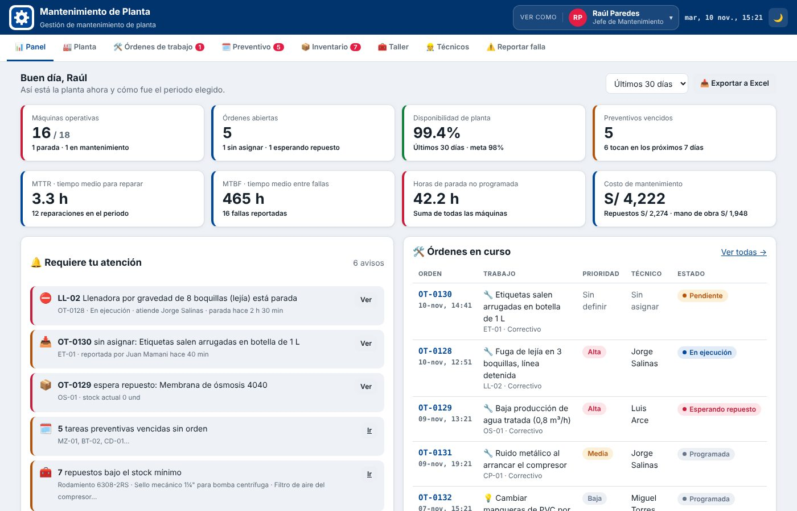
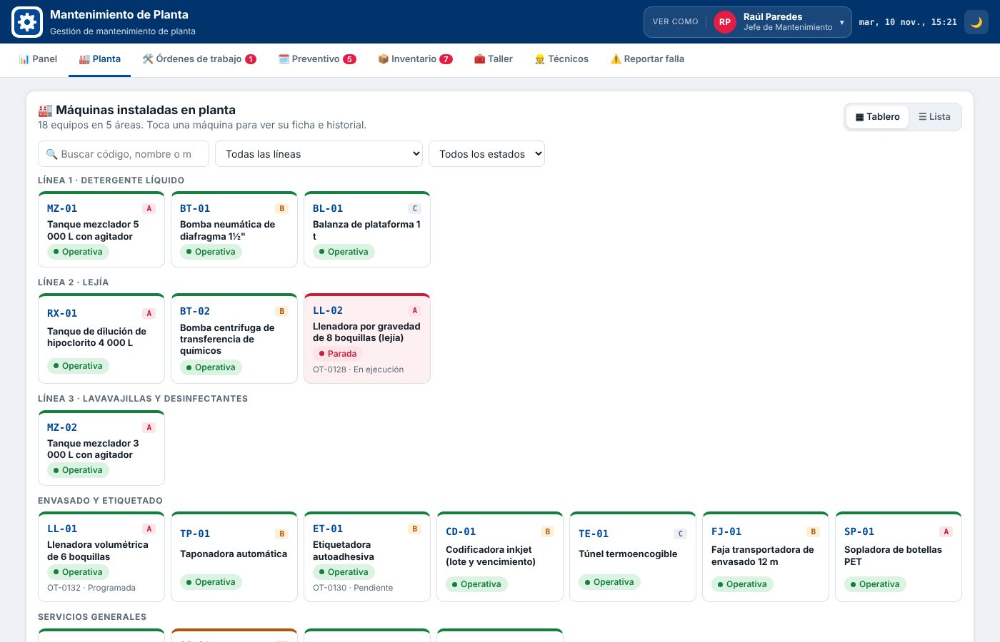
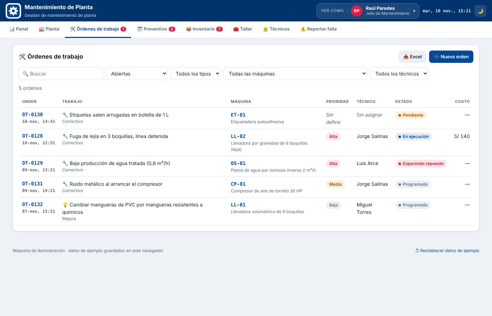
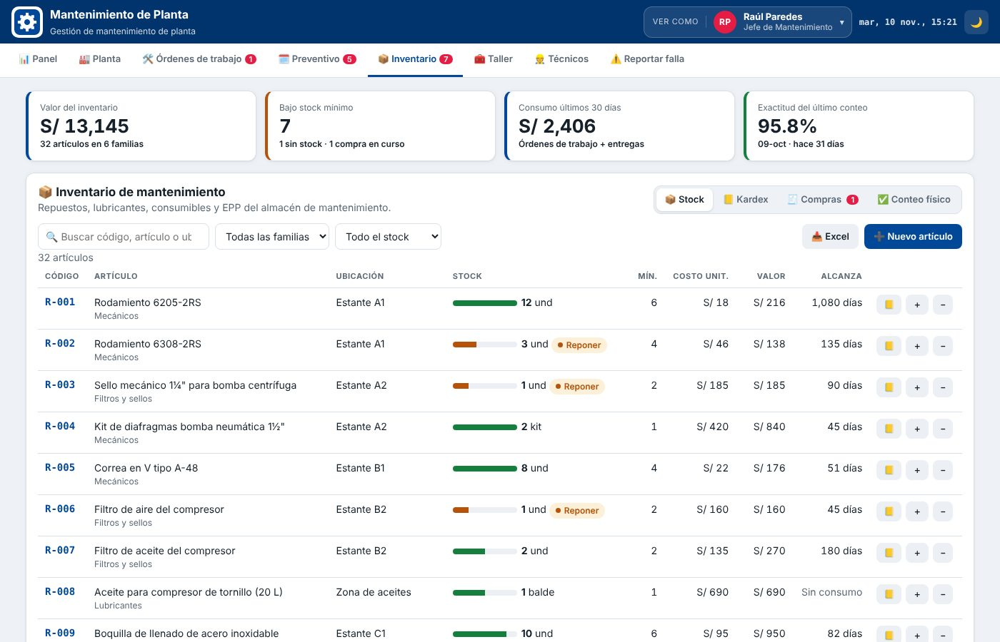
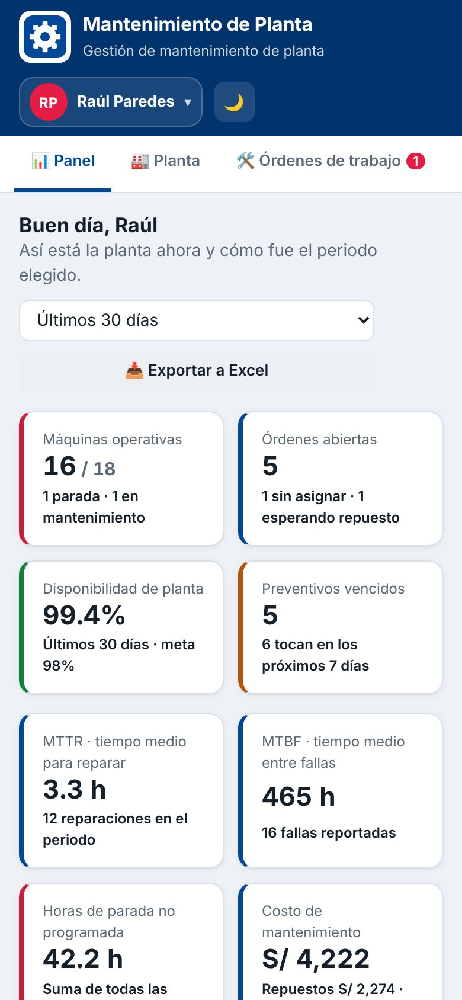

# Gestión de Mantenimiento de Planta

Prototipo web de un sistema de gestión de mantenimiento (CMMS) para una planta industrial que fabrica productos de limpieza. Está pensado como panel de control para el **jefe de mantenimiento**, con vistas para **técnicos** y **operadores de producción**.

🔗 **Demo en vivo:** https://carloscahuana12.github.io/gestion-mantenimiento-planta/

> Todos los datos son ficticios. La demo guarda los cambios en tu navegador; con **"Restablecer datos de ejemplo"** (al pie de la página) vuelve al estado inicial.

## Qué resuelve

En muchas plantas, las fallas se reportan de palabra, los repuestos se controlan en un Excel y nadie sabe cuánto cuesta realmente el mantenimiento de cada máquina. Este prototipo junta todo en un solo lugar:

- **Panel del jefe:** máquinas operativas y paradas, órdenes abiertas, disponibilidad de planta, **MTTR**, **MTBF**, horas de parada y costo de mantenimiento (repuestos + mano de obra), con avisos de lo que requiere atención.
- **Planta:** las 18 máquinas por línea de producción, con su ficha, criticidad (A/B/C), historial y plan preventivo.
- **Órdenes de trabajo:** el operador reporta la falla → el jefe asigna técnico y prioridad → el técnico inicia, descuenta repuestos y cierra con causa y solución. El estado de la máquina se actualiza solo.
- **Plan preventivo:** tareas por frecuencia, vencidas y próximas, agenda de 14 días y generación de órdenes con un clic.
- **Inventario:** stock por familia (mecánicos, eléctricos, filtros y sellos, lubricantes, consumibles, EPP), kardex con saldo, solicitudes de compra y conteo físico con ajustes automáticos.
- **Taller:** préstamo y devolución de herramientas y trabajos en curso.
- **Técnicos:** carga de trabajo y horas registradas.
- **Exportar a Excel** los indicadores, órdenes, máquinas, plan e inventario.

## Cómo probarlo

1. Abre la demo.
2. Arriba, en **"Ver como"**, elige a **Rosa Quispe (operadora)** y reporta una falla con la máquina detenida.
3. Cambia a **Raúl Paredes (jefe)**: aparece el aviso en el panel. Asígnale la orden a un técnico.
4. Cambia a **Jorge Salinas (técnico)**: inicia el trabajo, descuenta un repuesto y cierra la orden.
5. Vuelve al jefe: el stock bajó en el inventario y la máquina volvió a estar operativa.

## Capturas

| Planta | Órdenes de trabajo |
|---|---|
|  |  |

| Inventario | Celular |
|---|---|
|  |  |

## Tecnología

- HTML, CSS y JavaScript sin frameworks.
- Datos guardados en `localStorage` del navegador (es una maqueta, sin servidor).
- [SheetJS](https://sheetjs.com/) para exportar a Excel.
- Tema claro y oscuro, adaptable a celular.

## Indicadores que calcula

| Indicador | Cómo se calcula |
|---|---|
| Disponibilidad | 1 − (horas de parada no programada ÷ horas programadas) |
| MTTR | Promedio de horas de parada por reparación |
| MTBF | Horas de operación ÷ número de fallas |
| Costo | Repuestos usados + horas de trabajo × tarifa por hora |

## Autor

**Carlos Augusto Quispe Cahuana** · Analista de Soporte TI · Lima, Perú
[LinkedIn](https://www.linkedin.com/in/carlos-augusto-quispe-cahuana-0872b22b3)
